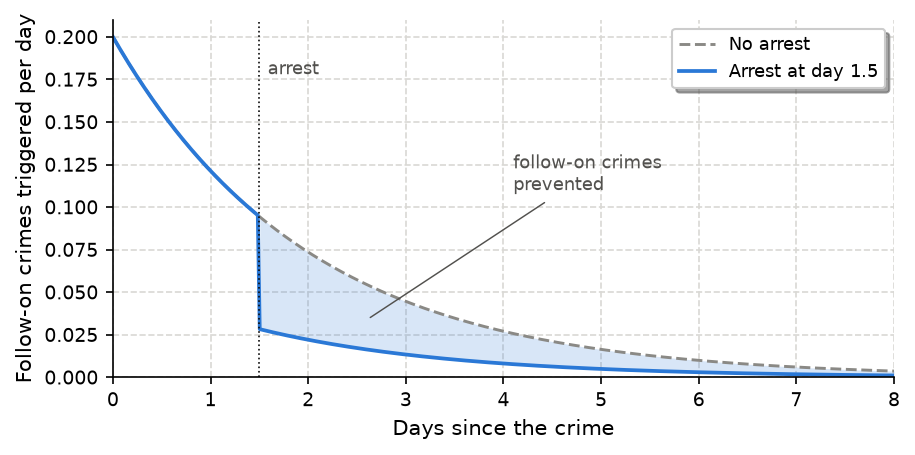
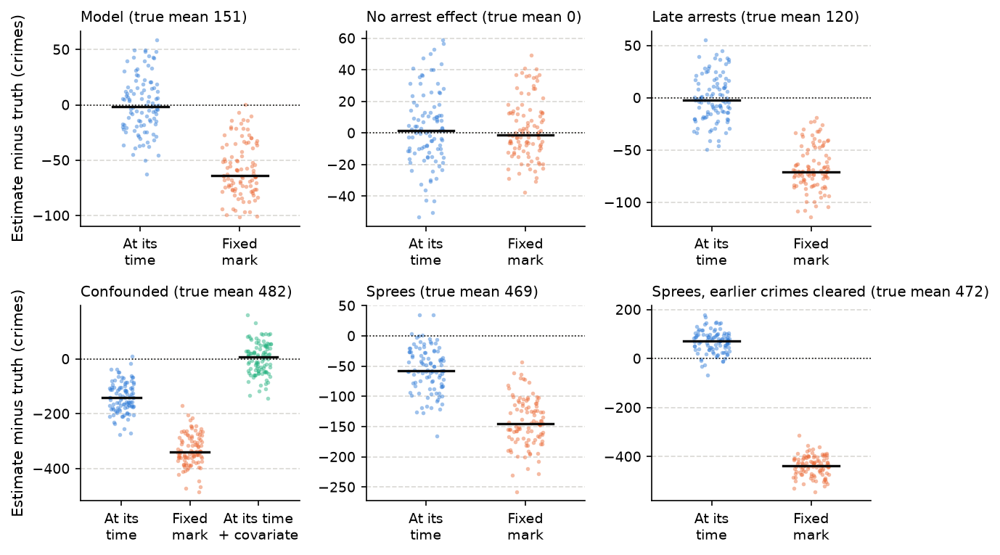
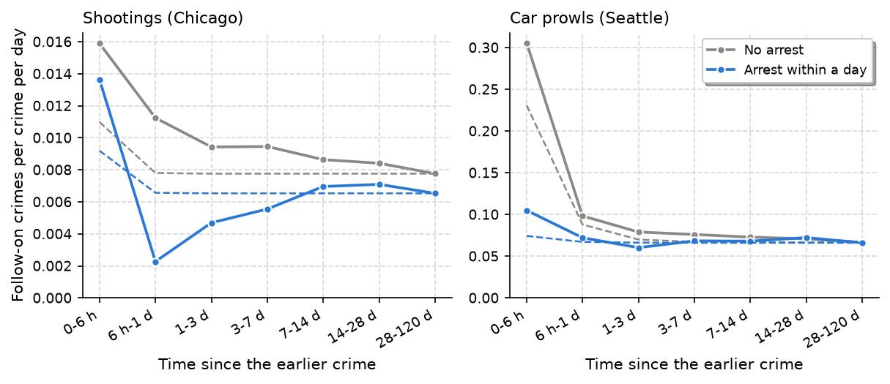
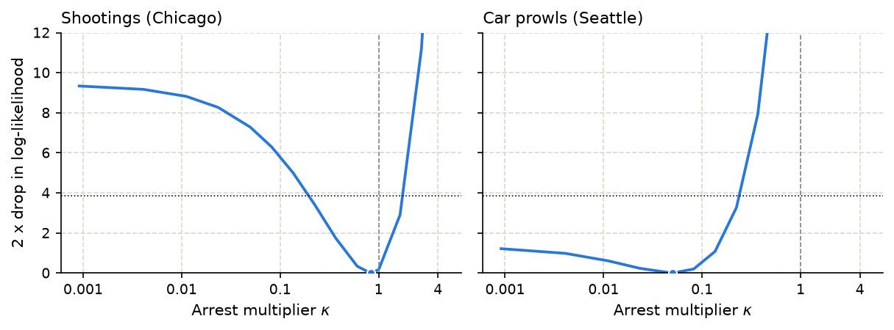
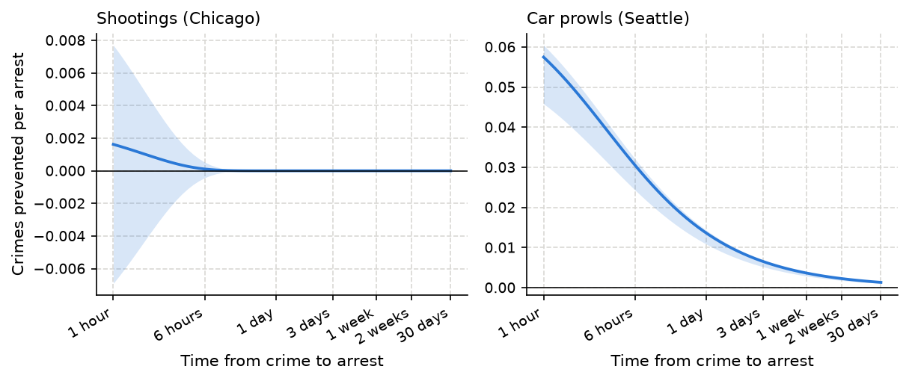

# Breaking the chain in a self-exciting point process: estimating the repeat crimes an arrest prevents
Andrew P. Wheeler

# Introduction

Crimes cluster in space and time beyond what stable hot spots explain. A shooting is followed by a retaliatory shooting a few blocks away. Someone breaking into cars works their way down a street tonight and comes back to the same garage later in the week. Self-exciting point process models capture this by letting each crime temporarily raise the rate of further crimes nearby ([Mohler et al. 2011](#ref-mohler2011); [Mohler 2014](#ref-mohler2014); [Reinhart 2018](#ref-reinhart2018review)), and they are the engine behind a generation of crime forecasting tools ([Mohler et al. 2015](#ref-mohler2015)).

In those models every crime excites. Nothing in them represents the police ending the chain. But the two stories above each have an obvious way to stop: the person doing it gets arrested. In prior work we showed the pattern with near repeat counts. For shootings, robberies, residential burglaries, and thefts from motor vehicles in Dallas, crimes that resulted in an arrest were 20% to 40% less likely to be followed by another crime nearby in the following days ([Wheeler, Riddell, and Haberman 2021](#ref-wheeler2021chain)). Those were logistic regressions for whether any follow-up crime occurred within a set distance and time. A model of that form does not convert easily into a count of crimes prevented, and it does not describe how the value of an arrest changes with how quickly it is made.

This paper adds a term to the self-exciting model that does the opposite of exciting. Each crime starts with the usual triggering kernel. If and when the crime has an arrest, whatever triggering it had left is multiplied by a factor $\kappa$. A value of $\kappa = 1$ means arrests change nothing, $\kappa = 0$ means an arrest ends the chain, and values between are partial dampening. Because the arrest enters the model at the time it happens, a fast arrest removes more of the kernel than a slow one, and an arrest made months later removes almost nothing. The fitted model converts directly into the quantity of interest: the expected number of follow-on crimes each arrest prevented, and the total across all arrests, including the crimes those prevented crimes would have gone on to trigger.

I lay out the model and its likelihood, show in simulations that it recovers the arrest effect and the count of crimes prevented, including when the data come from an offender spree process it only approximates, and apply it to shootings in Chicago, Illinois and car prowls (thefts from motor vehicles) in Seattle, Washington. The method needs data that say which crime had an arrest and when. Most open crime data lack this, and these two cities publish it. Code, data, and paper source are at https://github.com/apwheele/ArrestHawkes.

# Model

## A self-exciting model for crime

Crimes are points $(t_i, s_i)$, $i = 1, \dots, N$, with times $t_i$ in an observation window $[0, T]$ and locations $s_i$ in the plane. A point process is defined by its conditional intensity $\lambda(t, s)$, the expected rate of crimes per unit time and area at $(t, s)$ given everything that happened before $t$. The self-exciting (Hawkes) model ([Hawkes 1971](#ref-hawkes1971); [Ogata 1998](#ref-ogata1998); [Mohler et al. 2011](#ref-mohler2011)) is

```math
\lambda(t, s) = \mu(t, s) + \sum_{i:\, t_i < t} \theta_i \, g(t - t_i) \, h(s - s_i).
```

The background $\mu(t, s)$ is crime that would happen regardless of recent events: chronic hot spots, seasonality, long-run trends. Each past crime adds a bump on top. The temporal kernel $g$ and the spatial kernel $h$ are probability densities, so $\theta_i$ is the expected number of crimes triggered directly by crime $i$, its productivity. The model has a branching interpretation that I use throughout: every crime is either a background event or the offspring of exactly one earlier crime, offspring have offspring of their own, and if productivity averages $n < 1$ then one background crime leads to $1/(1 - n)$ crimes in total, counting itself.

I let productivity depend on characteristics of the crime known at the time, $\theta_i = \exp(x_i^\top \gamma)$, for example whether a shooting injured someone. For the spatial kernel I use a bivariate Gaussian with standard deviation $\sigma$. For the temporal kernel, write $S(u) = \int_u^\infty g(v)\, dv$ for the share of a crime’s triggering that is still to come $u$ days after it. I fit two forms and choose by likelihood: the exponential, $g(u) = \omega e^{-\omega u}$ with $S(u) = e^{-\omega u}$, and a power law (the Omori law of earthquake aftershocks, Ogata ([1988](#ref-ogata1988))), $g(u) = (p - 1)\, c^{\,p-1} (u + c)^{-p}$ with $S(u) = (1 + u/c)^{-(p - 1)}$, which has a sharper peak and a longer tail.

## Arrests dampen what triggering is left

Let $a_i$ be the time of the arrest for crime $i$, with $a_i = \infty$ if there is none, and let $A_i(t) = 1$ if $a_i < t$ and 0 otherwise. The model with arrest dampening is

```math
\lambda(t, s) = \mu(t, s) + \sum_{i:\, t_i < t} \theta_i \, \kappa_i^{A_i(t)} \, g(t - t_i) \, h(s - s_i).
```

Before the arrest, crime $i$ excites as usual. From the arrest on, its kernel is multiplied by $\kappa_i \ge 0$ (<a href="#fig-schematic" class="quarto-xref">Figure 1</a>). I mostly use a single $\kappa$, but the multiplier can depend on characteristics of the arrest, $\kappa_i = \exp(z_i^\top \beta)$, for example whether the person was booked into jail or released. The intensity only uses arrests made before $t$, so it is a valid conditional intensity, and it stays non-negative for any $\kappa_i \ge 0$. General inhibition in Hawkes processes, where events subtract from the intensity, needs a nonlinear link to keep the intensity positive and complicates estimation ([Bonnet, Martinez Herrera, and Sangnier 2021](#ref-bonnet2021)); scaling a crime’s own kernel avoids that.



The expected number of direct offspring of a crime arrested after a delay $d_i = a_i - t_i$ is the full-strength part before the arrest plus the dampened part after,

```math
m_i = \theta_i \left[ 1 - S(d_i) \right] + \theta_i \kappa_i S(d_i)
    = \theta_i \left[ 1 - (1 - \kappa_i)\, S(d_i) \right],
```

so the arrest removes $\theta_i (1 - \kappa_i) S(d_i)$ direct offspring. With the exponential kernel that is $\theta_i (1 - \kappa_i) e^{-\omega d_i}$: an arrest at the scene ($d_i = 0$) removes the share $1 - \kappa_i$ of everything the crime would have triggered, and each $\log(2)/\omega$ days of delay cuts what the arrest can prevent in half.

What $\kappa$ picks up depends on the crime. For a spree, where follow-on crimes are the same person continuing, the arrest incapacitates and $\kappa$ should be near zero if the right person is in custody. For retaliatory violence the follow-on crime is committed by someone else, and an arrest may or may not satisfy the other side ([Papachristos 2009](#ref-papachristos2009)), so $\kappa$ could be anywhere, in principle even above one.

## Why the arrest has to enter at the time it happens

A simpler model treats an eventual arrest as a fixed characteristic of the crime, the way Park et al. ([2021](#ref-park2021)) let gang crimes that received a violence interruption response have their own triggering rate. With arrests that is wrong in a way that matters. The crime’s follow-on crimes that came before the arrest could not have been affected by it, but the fixed-mark model counts them as evidence about $\kappa$. This is the immortal time bias of survival analysis ([Suissa 2008](#ref-suissa2008)), and here it runs in a known direction: it pulls the estimate of $\kappa$ toward one. It is worse than that when arrests clear several crimes at once. If a car prowler is caught on the third night and the arrest clears all three reports, the first two crimes are “arrested” crimes that each had a follow-on crime, and the fixed-mark model reads arrests as failing to stop anything. Entering the arrest as a change at time $a_i$ uses only what came after it.

## Likelihood

The log-likelihood of a point process on $[0, T]$ is the sum of the log intensity at the observed events minus the integral of the intensity,

```math
\ell = \sum_{j=1}^{N} \log \lambda(t_j, s_j) - \int_0^T \!\! \int \lambda(t, s)\, ds\, dt .
```

The integral has a closed form. Let $c_i = \min(a_i, T) - t_i$ be the time crime $i$ spends at full strength inside the window. Ignoring the small part of the spatial kernels that falls outside the city,

```math
\int_0^T \!\! \int \lambda \, ds\, dt = \int_0^T \!\! \int \mu \, ds\, dt
 + \sum_{i=1}^{N} \theta_i \left\{ \left[ 1 - S(c_i) \right] + \kappa_i \left[ S(c_i) - S(T - t_i) \right] \right\} .
```

Each term is the expected offspring of crime $i$ in the window: the share due before the arrest at full strength, and the share due between the arrest and $T$ multiplied by $\kappa_i$. For a crime with no arrest by $T$ the second piece is zero. The arrest times are treated as given. This is a partial likelihood: I do not model when arrests happen, only what happens to the crime rate after they do.

The parameters are estimated by maximizing $\ell$. I supply the analytic gradient and use L-BFGS, with standard errors from the inverse of the numerically differentiated Hessian. The likelihood can have more than one local maximum (a short, tight kernel or a long, wide one), so each fit starts from several kernel scales and keeps the best. The test of $\kappa = 1$ is a likelihood ratio test against the model without the arrest term. When $\kappa$ is near zero its log is poorly described by a normal distribution, so I report profile likelihood intervals: the values of $\kappa$ whose best-fitting likelihood is within 1.92 of the maximum.

## Background

The background is separable, $\mu(t, s) = \nu(t)\, b(s)$. The temporal part $\nu(t)$ is a step function with a free level for each quarter, which absorbs trends and seasonality that would otherwise be read as contagion. The spatial part $b(s)$ is a kernel density estimate built from the crime locations themselves, with a variable bandwidth as in Mohler et al. ([2011](#ref-mohler2011)): each crime contributes a Gaussian whose standard deviation is the distance to its $k$-th nearest neighbor (no smaller than 40 meters), so the surface is sharp where crime is dense and smooth where it is sparse. The density at crime $j$ leaves out crime $j$’s own kernel. A smoother background leaves more clustering for the triggering term to explain, so the choice of $k$ matters for $\theta$. I choose $k$ by the likelihood and report how the results move across values.

## Crimes prevented

The direct offspring removed by the arrests made in the window are

```math
D = \sum_{i:\, a_i \le T} \theta_i (1 - \kappa_i) \left[ S(c_i) - S(T - t_i) \right].
```

Each of those crimes would have triggered others. Let $n_0 = \frac{1}{N} \sum_i \theta_i$ be the average productivity with no arrest effect and $n_1 = n_0 - D/N$ the average productivity given the arrests made. With $B$ background crimes, the expected totals are $B/(1 - n_0)$ without the arrest effect and $N = B/(1 - n_1)$ with it, and the difference is

```math
P = \frac{B}{1 - n_0} - \frac{B}{1 - n_1} = \frac{D}{1 - n_0} .
```

This is the estimate of crimes prevented: the number of additional crimes expected had the same arrests been made with no effect on triggering. For a single arrest of an average crime made after a delay $d$ it is $\bar\theta (1 - \kappa) S(d) / (1 - n_0)$, which gives a curve of crimes prevented against time to arrest.

$P$ is an expected count. The number of crimes actually prevented is random even if the parameters were known, because how many crimes a crime triggers is random. The removed direct offspring are Poisson with mean $D$, and each would have started a family of crimes whose size has mean $1/(1 - n_0)$ and variance $n_0/(1 - n_0)^3$, so the realized count has variance $D \left[ n_0/(1 - n_0)^3 + 1/(1 - n_0)^2 \right]$ around $P$. The intervals I report for crimes prevented are prediction intervals for the realized count. They start from the interval for $P$ implied by the profile likelihood for $\kappa$ (refitting the other parameters at each end) and widen each side by this process variance, combining the two in quadrature.

## What has to hold

The model compares what follows arrested crimes, after their arrests, with what follows other crimes at the same lag. Reading $\kappa$ as the effect of the arrest needs three things. First, crimes that get arrests must not differ in productivity for other reasons, given the covariates in $\theta_i$. A domestic shooting is both easier to clear and less likely to spark retaliation, which would make arrests look more effective than they are; a prolific offender who is eventually caught would make them look less effective. Second, the arrest must not have been caused by the absence of follow-on crimes or the reverse, beyond the time ordering the model already respects. Third, the arrest linked to the crime in the data must be the relevant one. An arrest that takes an offender off the street prevents that person’s future crimes whichever report it is filed under, and the model only credits it against the crime it is linked to.

# Simulations

I check the method on simulated cities where the number of crimes prevented is known. Each world is a 10 km square observed for four years. Background crimes arrive at two per day, 60% in 25 hot spots and the rest uniformly. Replaying the same random draws with the arrest effect switched off gives the crimes that would have occurred, and the difference from the crimes that did occur is the true number prevented. There are six scenarios and 100 worlds each, averaging 4,600 crimes and 830 arrests per world.

The first four draw from the model itself, with productivity $\theta = 0.35$, an exponential kernel with a mean of two days ($\omega = 0.5$), $\sigma = 120$ meters, and 15% of crimes arrested.

- *Model.* $\kappa = 0.3$. Forty percent of arrests are at the scene and the rest follow after an exponential delay averaging three days.
- *No arrest effect.* The same with $\kappa = 1$.
- *Late arrests.* $\kappa = 0.3$ and no arrests at the scene; delays average two days, as long as the triggering lasts.
- *Confounded.* $\kappa = 0.3$. Thirty percent of crimes have a trait that doubles their productivity and quadruples their odds of arrest.

The last two do not come from the model. They simulate offenders. A spree starts as a background crime; after each crime the offender commits another with probability 0.45 after an exponential gap averaging two days, a short distance away. Each crime leads to an arrest with probability 0.15, half at the scene and half after a delay averaging two days, and an arrest removes every later crime in the spree.

- *Sprees.* The arrest is recorded against the crime that led to it.
- *Sprees, earlier crimes cleared.* The arrest also clears 70% of the offender’s earlier crimes, recorded with the same arrest time.

For each world I fit the model with the arrest entering at its time, and the fixed-mark version that treats an eventual arrest as a characteristic of the crime. In the confounded scenario I also fit the model with the trait as a productivity covariate.

<div class="cell-output cell-output-display cell-output-markdown" execution_count="3">

| Scenario                       | Method                         | True $\kappa$ | Median $\kappa$ | Reject $\kappa$ = 1 | Cover $\kappa$ | Prevented, true | Prevented, est. | Cover prevented |
|:-------------------------------|:-------------------------------|--------------:|----------------:|--------------------:|---------------:|----------------:|----------------:|----------------:|
| Model                          | Arrest at its time             |           0.3 |            0.29 |                100% |            97% |             151 |             151 |             95% |
| Model                          | Arrest as fixed mark           |           0.3 |            0.56 |                100% |                |             151 |              93 |                 |
| No arrest effect               | Arrest at its time             |           1.0 |            0.99 |                  7% |            93% |               0 |               3 |             96% |
| No arrest effect               | Arrest as fixed mark           |           1.0 |            1.00 |                  3% |                |               0 |               2 |                 |
| Late arrests                   | Arrest at its time             |           0.3 |            0.28 |                100% |            98% |             120 |             120 |             96% |
| Late arrests                   | Arrest as fixed mark           |           0.3 |            0.69 |                 98% |                |             120 |              53 |                 |
| Confounded                     | Arrest at its time             |           0.3 |            0.36 |                100% |            77% |             482 |             343 |             20% |
| Confounded                     | Arrest as fixed mark           |           0.3 |            0.71 |                100% |                |             482 |             150 |                 |
| Confounded                     | Arrest at its time + covariate |           0.3 |            0.29 |                100% |            95% |             482 |             484 |             92% |
| Sprees                         | Arrest at its time             |           0.0 |            0.00 |                100% |           100% |             469 |             414 |             69% |
| Sprees                         | Arrest as fixed mark           |           0.0 |            0.22 |                100% |                |             469 |             327 |                 |
| Sprees, earlier crimes cleared | Arrest at its time             |           0.0 |            0.00 |                100% |            99% |             472 |             542 |             62% |
| Sprees, earlier crimes cleared | Arrest as fixed mark           |           0.0 |            0.92 |                 20% |                |             472 |              34 |                 |

</div>



<a href="#tbl-sim" class="quarto-xref">Table 1</a> and <a href="#fig-sim" class="quarto-xref">Figure 2</a> give the results. When the data come from the model, the estimate of $\kappa$ is centered on the truth (median 0.29 against 0.3), the test rejects no effect in 100% of worlds, and the estimate of crimes prevented averages 151 against a true 151. With no arrest effect the test rejects in 7% of worlds, close to its nominal 5%. Profile intervals for $\kappa$ cover in 97% of worlds and the intervals for crimes prevented in 95%.

The fixed-mark model is biased in every scenario where arrests take time. Its median $\kappa$ is 0.56 in the first scenario and 0.69 when all arrests are late, and it finds 56% fewer crimes prevented than there were. When one arrest clears a string of earlier crimes it fails entirely: median $\kappa$ of 0.92, in a world where every arrest ends a spree.

Confounding does what it should. Leaving out a trait that raises both productivity and the chance of arrest makes arrested crimes look more productive, so $\kappa$ is overstated (median 0.36) and crimes prevented understated. With the trait in the model the bias is gone (0.29).

In the spree worlds the model is only an approximation: an offender commits at most one next crime, where the model’s crimes have a Poisson number of offspring. It still reads the arrest correctly. The estimate of $\kappa$ goes to zero (median 0.001), and estimated crimes prevented average 414 against a true 469, an underestimate of 12%. When arrests also clear earlier crimes the estimate of $\kappa$ still goes to zero, but crimes prevented are overstated by 15% (542 against 472). Each earlier crime cleared by the arrest is credited with removing what was left of its own kernel, although the one arrest had already ended the spree. Where an arrest clears a string of crimes it should be attached to the last of them. In both spree scenarios the intervals, which take the model as given, are too narrow: they cover the true count in 69% and 62% of worlds.

# Data

The model needs, for each crime, a time, a location, and the time of the arrest if there was one, and the arrests have to be complete enough that an unarrested crime really had no arrest. Few police departments publish that. Our earlier near repeat analysis used Dallas ([Wheeler, Riddell, and Haberman 2021](#ref-wheeler2021chain)), but its public arrest table is missing about half of the arrests its incident table reports (below). I use Chicago for shootings and Seattle for car prowls. In both, every arrest is tied to the crime by its case number and has a date and time. The data were downloaded in November 2026.

*Shootings: Chicago, Illinois.* The city’s violence reduction data list every victim of a homicide or non-fatal shooting, with the case number, the date and time, whether the victim was shot, and a location moved from the address but kept on the same block ([City of Chicago 2026](#ref-cpdvictims)). A shooting incident here is a case number with at least one gunshot victim, fatal if any victim died, from January 2016 through June 2026. That gives 27,385 incidents, of which 5,643 were fatal; all have coordinates. Whether a shooting was fatal is a productivity covariate. The arrest table has one row per arrest with the date and time, the charges, and, for about 70% of arrests, the case number of the crime ([Chicago Police Department 2026](#ref-cpdarrests)). I link each shooting to the earliest arrest under its case number. An arrest under the same case number is not always of the shooter: of the linked shootings, 15% have only arrests on gun possession, drug, or other charges, which may be of a victim or bystander. The main analysis counts any arrest under the case number, and a sensitivity analysis counts only arrests with a violent charge or on a warrant.

<div class="cell-output cell-output-display cell-output-markdown" execution_count="5">

| Year      | Shootings | Open data, any arrest | Open data, violent charge |                                               Published |
|:----------|:----------|----------------------:|--------------------------:|--------------------------------------------------------:|
| 2022      | Fatal     |                   23% |                       20% |                     27% (CBS Chicago, from CPD records) |
| 2023      | Fatal     |                   21% |                       19% |                      17%, first 10 months (CBS Chicago) |
| 2021-2024 | Fatal     |                   21% |                       19% |      25% cleared by arrest, year not stated (Sun-Times) |
| 2024      | Non-fatal |                   10% |                        7% |              141 of about 2,300 victims, 6% (Sun-Times) |
| 2018-2024 | Non-fatal |                    8% |                        6% | 1,200 of more than 19,000 victims, about 6% (Sun-Times) |

</div>

<a href="#tbl-check" class="quarto-xref">Table 2</a> compares the arrest share in the open data with arrest rates reported from police records by CBS Chicago, which obtained them under the Freedom of Information Act ([De Mar 2024](#ref-cbs2024)), and the Chicago Sun-Times ([Grimm, Schuba, and Boyle 2025](#ref-suntimes2025)). Both separate arrests from the much larger number of cases closed by exceptional means. The open data land in the same range: about one in five fatal shootings and one in fifteen non-fatal shootings had an arrest. The published non-fatal figures count victims, and an incident can have several, so per incident they would be somewhat higher.

*Car prowls: Seattle, Washington.* The Seattle Police Department’s crime table has one row per offense with the report number, the date and time of the offense, and a location masked to the hundred block ([Seattle Police Department 2026b](#ref-spdcrime)). Its arrest table starts in 2019 and has one row per arrest charge with the date and time of the arrest, the report number of the case, and the type of arrest ([Seattle Police Department 2026a](#ref-spdarrest)). Car prowls are offenses coded theft from motor vehicle, from January 2019 through June 2026, which leaves four months for late-entered arrests. The offense time is the start of the period the victim reports, and for a car broken into overnight that can be off by hours. In both cities I link each case to the earliest arrest with the same number, and an arrest logged shortly before the offense time (39 shootings, 34 car prowls) is treated as made at the scene.

*Cities that did not work.* Seattle also flags shootings, but its public file redacts the location of nearly all fatal shootings. In Dallas, the incident table’s own case status says that 36% to 60% of gun homicides each year were cleared by arrest, but only half of the incidents with that status appear in the public arrest table, the only source of an arrest date, and only a few percent of gun homicides do. In Baltimore, arrests that carry an incident number link to about 9% of shootings, against a clearance rate the department reports at over 50%. Philadelphia publishes shootings with exact times and locations but arrests only as daily counts by area; its arrests can be found in Pennsylvania court dockets by incident number, but the court portal limits searches to about one a minute. Other large cities either publish no arrest table with a case number or anonymize the case number.

Both cities publish the block and not the address, so many cases share identical coordinates, which a continuous spatial kernel cannot handle (the likelihood is unbounded as $\sigma$ goes to zero). I add Gaussian noise with a standard deviation of 30 meters to each coordinate, about the spread of a uniform position along a block, and check how much results depend on the random draw.

<div class="cell-output cell-output-display cell-output-markdown" execution_count="6">

|                      | Period               |  Cases | With location | With an arrest | Arrest within an hour | Arrest after a week or more |
|:---------------------|:---------------------|-------:|--------------:|---------------:|----------------------:|----------------------------:|
| Shootings (Chicago)  | Jan 2016 to Jun 2026 | 27,386 |        27,385 |  2,742 (10.0%) |                   29% |                         50% |
| Car prowls (Seattle) | Jan 2019 to Jun 2026 | 66,960 |        66,355 |     722 (1.1%) |                   75% |                          8% |

</div>

<a href="#tbl-data" class="quarto-xref">Table 3</a> describes the two samples. Arrests are uncommon: 10.0% of shootings and 1.1% of car prowls have one. The timing differs. 75% of car prowl arrests are within an hour of the offense, people caught in the act. Shooting arrests are mostly the product of an investigation: 29% come within an hour and 50% a week or more later. Seattle’s arrest table also records the type of arrest. 49% of car prowl arrests do not end with the person booked into jail (they are identified and released, cited, or referred for charges), which lets the model ask whether custody is what matters.



<a href="#fig-followon" class="quarto-xref">Figure 3</a> shows the pattern the model has to explain, before any model. For each crime I count later crimes of the same type within 200 meters and divide by the time at risk. In the six hours after a car prowl with no arrest, further car prowls nearby come at 4.6 times the long-run rate at those places, and the excess decays over the following days. After a car prowl with an arrest within a day the spike is mostly gone (1.6 times the long-run rate, from 17 pairs).

Chicago shootings show the same shape on a smaller scale. In the six hours after a shooting with no arrest, further shootings within 200 meters come at 2.0 times the long-run rate, and in the first day there are 306 such follow-on shootings where the long-run rate implies 191. After the 1,173 shootings with an arrest within a day, 6 followed nearby in the next day, where 7.7 would be expected at the long-run rate.

# Results

<div class="cell-output cell-output-display cell-output-markdown" execution_count="9">

|                      | Model                           | Log-likelihood | Parameters |         AIC |
|:---------------------|:--------------------------------|---------------:|-----------:|------------:|
| Shootings (Chicago)  | Poisson background              |     -496,084.9 |         42 |   992,253.8 |
|                      | Self-exciting, no arrest effect |     -495,927.3 |         46 |   991,946.7 |
|                      | Arrest as a fixed mark          |     -495,925.3 |         47 |   991,944.6 |
|                      | Arrest dampening (main)         |     -495,927.3 |         47 |   991,948.5 |
| Car prowls (Seattle) | Poisson background              |   -1,061,275.8 |         30 | 2,122,611.6 |
|                      | Self-exciting, no arrest effect |   -1,056,804.7 |         34 | 2,113,677.3 |
|                      | Arrest as a fixed mark          |   -1,056,786.3 |         35 | 2,113,642.6 |
|                      | Arrest dampening (main)         |   -1,056,787.3 |         35 | 2,113,644.7 |
|                      | Arrest dampening by custody     |   -1,056,787.0 |         36 | 2,113,645.9 |

</div>

<div class="cell-output cell-output-display cell-output-markdown" execution_count="10">

|                                       |    Shootings (Chicago) |   Car prowls (Seattle) |
|:--------------------------------------|-----------------------:|-----------------------:|
| Kernel                                |            Exponential |              Power law |
| Background neighbors k                |                      5 |                      5 |
| Productivity $\theta$                 | 0.018 (0.015 to 0.021) | 0.072 (0.068 to 0.075) |
| Fatal shooting multiplier on $\theta$ |    0.52 (0.30 to 0.91) |                        |
| Arrest multiplier $\kappa$            |    0.83 (0.19 to 1.78) |    0.05 (0.00 to 0.24) |
| Test of $\kappa$ = 1, p-value         |                  0.683 |               \< 0.001 |
| Median lag to a triggered crime       |              1.3 hours |              4.0 hours |
| Spatial spread $\sigma$ (meters)      |       610 (553 to 673) |          73 (70 to 76) |
| Share of crimes triggered             |                   1.6% |                   7.1% |

</div>

For each crime type I fit both temporal kernels with the background’s nearest-neighbor count $k$ at 5, 10, 15, and 30, and take the combination with the highest likelihood (<a href="#tbl-grid" class="quarto-xref">Table 7</a> in the appendix has all of them). <a href="#tbl-models" class="quarto-xref">Table 4</a> compares models at that choice and <a href="#tbl-est" class="quarto-xref">Table 5</a> gives the estimates.

## Car prowls

Car prowls are self-exciting, modestly. The self-exciting model improves the log-likelihood over the background alone by 4,471 with a handful of parameters, and 7.1% of car prowls are attributed to an earlier one. The triggering is fast and local. The power law kernel fits far better than the exponential, half of triggered car prowls come within 4 hours of the one that triggered them, and the spatial spread is 73 meters, about a block. This is what a spree looks like.

Arrests cut it off. The estimate of $\kappa$ is 0.05 (95% profile interval 0.00 to 0.24): after an arrest, a car prowl triggers about 95% fewer follow-on car prowls than it otherwise would have from that point. The likelihood ratio test against no arrest effect has a p-value \< 0.001 (<a href="#fig-profile" class="quarto-xref">Figure 4</a>). Because nearly all car prowl arrests are made within the hour, the fixed-mark model gives a similar answer here (0.10); the two would diverge in data with more follow-up arrests.



Does it matter whether the person goes to jail? 371 of the 722 car prowl arrests ended in a booking; the rest were identified and released, cited, or referred for charges. Letting $\kappa$ differ between the two gives 0.09 for arrests without a booking and an estimate at zero for arrests with one, but the likelihood ratio test of a difference has a p-value of 0.389. The data cannot tell the two apart. Both kinds of arrest are followed by far fewer car prowls than no arrest, which fits an offender who stops for the night once caught, in custody or not.

## Shootings

Chicago shootings are self-exciting, but only slightly. The self-exciting model improves the log-likelihood over the background alone by 158, and it attributes 1.6% of shooting incidents to an earlier one, with productivity 0.018. The triggering is fast and spread out: half of triggered shootings come within 76 minutes of the earlier one, and the spatial spread is 610 meters. That looks less like repeat shootings at one address than like an exchange of gunfire, or a retaliation the same night, a few blocks away. Fatal shootings trigger fewer follow-on shootings than non-fatal ones (multiplier 0.52 (0.30 to 0.91)). This fits Loeffler and Flaxman ([2018](#ref-loeffler2018)), who found with acoustic gunshot detection data that gun violence does spread, but only slightly. One caution on scope: an incident with several victims counts once here, and retaliation that follows social ties across the city ([Papachristos 2009](#ref-papachristos2009); [Green, Horel, and Papachristos 2017](#ref-green2017)) would not show up as clustering in space.

The data cannot tell whether arrests stop follow-on shootings. The estimate of $\kappa$ is 0.83, with a 95% profile interval of 0.19 to 1.78 that includes no effect (p-value 0.683). Counting only arrests with a violent charge or on a warrant gives 0.45 (0.00 to 1.48, p-value 0.255), and the estimate moves with the random draw used to unmask locations (0.63 and 0.62 with two other draws). The reason is in the timing. With half of the triggering over within about an hour, only an arrest in that hour can remove much of it, and only 29% of shooting arrests come that fast; the median arrest is 7 days after the shooting. The 2,717 shootings with an arrest by the end of June 2026 would trigger about 48 shootings between them with no arrest effect, most of them before any arrest.

## Crimes prevented

<div class="cell-output cell-output-display cell-output-markdown" execution_count="13">

|                      | Crimes | Arrests | Prevented, direct |    Prevented, total | Per 100 arrests | Share of crimes |
|:---------------------|-------:|--------:|------------------:|--------------------:|----------------:|----------------:|
| Shootings (Chicago)  | 27,385 |   2,717 |               2.1 |  2.2 (-9.6 to 10.7) |             0.1 |           0.01% |
| Car prowls (Seattle) | 66,355 |     722 |              39.1 | 42.2 (26.0 to 56.0) |             5.8 |           0.06% |

</div>



<a href="#tbl-prevented" class="quarto-xref">Table 6</a> turns the estimates into counts. The 722 car prowl arrests prevented an estimated 42 car prowls (95% interval 26 to 56), about 6 for every 100 arrests. The effect of an arrest is large in relative terms and small in absolute terms, and the reason is in the two numbers that multiply together. A car prowl triggers 0.07 others on average, so that is the most an arrest at the scene can prevent directly, and only 1.1% of car prowls have an arrest. Against 66,355 car prowls in the period, the chains broken by arrest are 0.06%.

<a href="#fig-curve" class="quarto-xref">Figure 5</a> shows how fast the value of an arrest decays. For car prowls an arrest at the scene prevents about 0.073 crimes; one made a day later prevents 0.014, because by then 81% of the follow-on crimes have already happened. For shootings the estimate is 2 shootings prevented in ten and a half years, with an interval (-10 to 11) that includes zero, and the curve falls to nothing within a few hours.

These counts are only the crimes prevented through this channel: the short-run chain that follows a specific crime. An arrest that incapacitates a prolific offender for months, or deters others, prevents crimes the triggering kernel never sees.

## Checks

The dashed lines in <a href="#fig-followon" class="quarto-xref">Figure 3</a> are a check on fit: the follow-on rates the fitted model implies, against the raw rates. For car prowls the model reproduces the spike in the first six hours and its absence after an arrest. It puts 0.31 observed against 0.23 implied in that first bin, and it is low over the next two weeks, where the raw rate stays a little above the long-run rate longer than a single kernel allows. For shootings the model accounts for only part of the excess in the first six hours within 200 meters, since its fitted spatial spread is wider than that. The usual residual check for point processes, rescaling time by the fitted citywide intensity so that gaps between crimes should be Exponential(1) ([Ogata 1988](#ref-ogata1988); [Brown et al. 2002](#ref-brown2002)), is not informative here. 49% of car prowl offense times are recorded on the hour and 17% of car prowls share a timestamp with the one before, so the residuals fail in the same way for every model (Kolmogorov-Smirnov distance 0.17 for the arrest model and 0.17 for the background alone). Crimes with identical recorded times also cannot be ordered, so neither counts as triggering the other, which makes the estimate of $\theta$ conservative.

The car prowl estimates do not depend on the random draw used to unmask locations: with two other draws $\kappa$ is 0.05 and 0.04 and crimes prevented 42 and 43. They do depend, as expected, on how smooth the background is (<a href="#tbl-grid" class="quarto-xref">Table 7</a>). A smoother background (larger $k$) hands more clustering to the triggering term, raising $\theta$ and with it the count of crimes prevented. For car prowls $\kappa$ itself stays between 0.05 and 0.07 across all eight combinations, and crimes prevented between 31 and 53.

# Discussion

The arrest term is a small change to a standard model, and it answers a question the standard model cannot: of the crimes a crime would have triggered, how many did the arrest stop? The estimate has a direct reading for police. For car prowls in Seattle, an arrest at the scene all but ends the elevated risk that follows a car prowl. A patrol response that catches someone in the act is worth far more, for this purpose, than an arrest a week later, because the risk the arrest can remove is gone within a day.

It also gives a sober accounting of scale. Near repeat patterns are sometimes presented as if interrupting them would move crime totals. Here the chains are short. If a car prowl triggers 0.07 others, then even arresting someone at the scene of every car prowl would prevent, through this channel, fewer than one in ten. The value of arrests for car prowls has to come mostly from somewhere else, such as incapacitating people who offend at a high rate for a long time or deterrence from the certainty of being caught ([Nagin 2013](#ref-nagin2013)), neither of which a triggering kernel measures. The shooting result says the same thing more bluntly: with shootings in Chicago close to independent given place and season, there is little chain in space and time to break.

Several limitations deserve mention. The estimate of $\kappa$ is observational. Arrested crimes are not a random sample, and I have only crude covariates to adjust for the difference; the simulation shows the direction of the bias when a trait raises both productivity and the chance of arrest. The arrest link is to one report, and an arrest that should be credited against a string of an offender’s crimes is credited against one. Chicago’s arrest table gives the case number for about 70% of arrests, so some arrests for shootings are missing; the arrest shares match published arrest rates closely but run a few points low for homicides, and a missing arrest biases the estimate of $\kappa$ toward one. Both cities publish the block and not the address, and Seattle’s car prowl times are imprecise for crimes discovered after the fact. And the model’s kernels are simple: one decay rate and one spatial scale for everything, where sprees within a night and returns to the same place weeks later are probably different processes.

Natural extensions follow from those. With offender identifiers, arrests could dampen the kernels of all of a person’s linked crimes at once. With gang or group data, the retaliation channel for shootings could be modeled on a network instead of in space ([Green, Horel, and Papachristos 2017](#ref-green2017)), where the question of whether an arrest satisfies or provokes the other side has more bite. The same dampening term would also work for any intervention attached to a crime with a timestamp, such as a violence interrupter’s response ([Park et al. 2021](#ref-park2021)) or a victim services contact. The data requirement is the binding constraint. Few cities publish which crime had an arrest and when, and of the large cities I checked only Chicago does so for shootings completely enough to use. Incident-based records reported to the FBI’s National Incident-Based Reporting System link arrests to offenses for thousands of agencies, but without locations; a version of the model in time alone could use them, and I plan to add that analysis.

# References

<div id="refs" class="references csl-bib-body hanging-indent" entry-spacing="0">

<div id="ref-bonnet2021" class="csl-entry">

Bonnet, Anna, Miguel Martinez Herrera, and Maxime Sangnier. 2021. “Maximum Likelihood Estimation for Hawkes Processes with Self-Excitation or Inhibition.” *Statistics & Probability Letters* 179: 109214. <https://doi.org/10.1016/j.spl.2021.109214>.

</div>

<div id="ref-brown2002" class="csl-entry">

Brown, Emery N., Riccardo Barbieri, Valérie Ventura, Robert E. Kass, and Loren M. Frank. 2002. “The Time-Rescaling Theorem and Its Application to Neural Spike Train Data Analysis.” *Neural Computation* 14 (2): 325–46. <https://doi.org/10.1162/08997660252741149>.

</div>

<div id="ref-cpdarrests" class="csl-entry">

Chicago Police Department. 2026. “Arrests.” Chicago Data Portal. <https://data.cityofchicago.org/d/dpt3-jri9>.

</div>

<div id="ref-cpdvictims" class="csl-entry">

City of Chicago. 2026. “Violence Reduction - Victims of Homicides and Non-Fatal Shootings.” Chicago Data Portal. <https://data.cityofchicago.org/d/gumc-mgzr>.

</div>

<div id="ref-cbs2024" class="csl-entry">

De Mar, Megan. 2024. “Proposed Illinois Legislation Would Shed Light on Homicide Clearance Rate.” CBS News Chicago. <https://www.cbsnews.com/chicago/news/proposed-illinois-legislation-homicide-clearance-rate/>.

</div>

<div id="ref-green2017" class="csl-entry">

Green, Ben, Thibaut Horel, and Andrew V. Papachristos. 2017. “Modeling Contagion Through Social Networks to Explain and Predict Gunshot Violence in Chicago, 2006 to 2014.” *JAMA Internal Medicine* 177 (3): 326–33. <https://doi.org/10.1001/jamainternmed.2016.8245>.

</div>

<div id="ref-suntimes2025" class="csl-entry">

Grimm, Andy, Tom Schuba, and Andy Boyle. 2025. “‘Where’s My Justice?’ Only 6% of Chicago Shootings Lead to Arrests, Sun-Times Finds.” Chicago Sun-Times. <https://chicago.suntimes.com/the-watchdogs/2025/03/14/non-fatal-shootings-clearance-rate-chicago-police-cpd-statistics>.

</div>

<div id="ref-hawkes1971" class="csl-entry">

Hawkes, Alan G. 1971. “Spectra of Some Self-Exciting and Mutually Exciting Point Processes.” *Biometrika* 58 (1): 83–90. <https://doi.org/10.1093/biomet/58.1.83>.

</div>

<div id="ref-loeffler2018" class="csl-entry">

Loeffler, Charles, and Seth Flaxman. 2018. “Is Gun Violence Contagious? A Spatiotemporal Test.” *Journal of Quantitative Criminology* 34 (4): 999–1017. <https://doi.org/10.1007/s10940-017-9363-8>.

</div>

<div id="ref-mohler2014" class="csl-entry">

Mohler, George O. 2014. “Marked Point Process Hotspot Maps for Homicide and Gun Crime Prediction in Chicago.” *International Journal of Forecasting* 30 (3): 491–97. <https://doi.org/10.1016/j.ijforecast.2014.01.004>.

</div>

<div id="ref-mohler2011" class="csl-entry">

Mohler, George O., Martin B. Short, P. Jeffrey Brantingham, Frederic P. Schoenberg, and George E. Tita. 2011. “Self-Exciting Point Process Modeling of Crime.” *Journal of the American Statistical Association* 106 (493): 100–108. <https://doi.org/10.1198/jasa.2011.ap09546>.

</div>

<div id="ref-mohler2015" class="csl-entry">

Mohler, George O., Martin B. Short, Sean Malinowski, Mark Johnson, George E. Tita, Andrea L. Bertozzi, and P. Jeffrey Brantingham. 2015. “Randomized Controlled Field Trials of Predictive Policing.” *Journal of the American Statistical Association* 110 (512): 1399–1411. <https://doi.org/10.1080/01621459.2015.1077710>.

</div>

<div id="ref-nagin2013" class="csl-entry">

Nagin, Daniel S. 2013. “Deterrence in the Twenty-First Century.” *Crime and Justice* 42 (1): 199–263. <https://doi.org/10.1086/670398>.

</div>

<div id="ref-ogata1988" class="csl-entry">

Ogata, Yosihiko. 1988. “Statistical Models for Earthquake Occurrences and Residual Analysis for Point Processes.” *Journal of the American Statistical Association* 83 (401): 9–27. <https://doi.org/10.1080/01621459.1988.10478560>.

</div>

<div id="ref-ogata1998" class="csl-entry">

———. 1998. “Space-Time Point-Process Models for Earthquake Occurrences.” *Annals of the Institute of Statistical Mathematics* 50 (2): 379–402. <https://doi.org/10.1023/A:1003403601725>.

</div>

<div id="ref-papachristos2009" class="csl-entry">

Papachristos, Andrew V. 2009. “Murder by Structure: Dominance Relations and the Social Structure of Gang Homicide.” *American Journal of Sociology* 115 (1): 74–128. <https://doi.org/10.1086/597791>.

</div>

<div id="ref-park2021" class="csl-entry">

Park, Junhyung, Frederic Paik Schoenberg, Andrea L. Bertozzi, and P. Jeffrey Brantingham. 2021. “Investigating Clustering and Violence Interruption in Gang-Related Violent Crime Data Using Spatial-Temporal Point Processes with Covariates.” *Journal of the American Statistical Association* 116 (536): 1674–87. <https://doi.org/10.1080/01621459.2021.1898408>.

</div>

<div id="ref-reinhart2018review" class="csl-entry">

Reinhart, Alex. 2018. “A Review of Self-Exciting Spatio-Temporal Point Processes and Their Applications.” *Statistical Science* 33 (3): 299–318. <https://doi.org/10.1214/17-STS629>.

</div>

<div id="ref-spdarrest" class="csl-entry">

Seattle Police Department. 2026a. “SPD Arrest Data.” City of Seattle Open Data Portal. <https://data.seattle.gov/Public-Safety/SPD-Arrest-Data/9bjs-7a7w>.

</div>

<div id="ref-spdcrime" class="csl-entry">

———. 2026b. “SPD Crime Data: 2008-Present.” City of Seattle Open Data Portal. <https://data.seattle.gov/Public-Safety/SPD-Crime-Data-2008-Present/tazs-3rd5>.

</div>

<div id="ref-suissa2008" class="csl-entry">

Suissa, Samy. 2008. “Immortal Time Bias in Pharmacoepidemiology.” *American Journal of Epidemiology* 167 (4): 492–99. <https://doi.org/10.1093/aje/kwm324>.

</div>

<div id="ref-wheeler2021chain" class="csl-entry">

Wheeler, Andrew P., Jordan R. Riddell, and Cory P. Haberman. 2021. “Breaking the Chain: How Arrests Reduce the Probability of Near Repeat Crimes.” *Criminal Justice Review* 46 (2): 236–58. <https://doi.org/10.1177/0734016821999707>.

</div>

</div>

# Appendix: sensitivity to the kernel and background

<div class="cell-output cell-output-display cell-output-markdown" execution_count="15">

|                      | Kernel      |   k | Bandwidth |  Log-likelihood | $\theta$ | $\kappa$ | p ($\kappa$ = 1) | Median lag (days) | $\sigma$ | Prevented |
|:---------------------|:------------|----:|----------:|----------------:|---------:|---------:|-----------------:|------------------:|---------:|----------:|
| Shootings (Chicago)  | Exponential |   5 |        96 |      -495,927.3 |    0.018 |     0.83 |            0.683 |              0.05 |      610 |       2.2 |
|                      | Exponential |  10 |       140 |      -497,324.9 |    0.018 |     0.74 |            0.521 |              0.05 |      613 |       3.3 |
|                      | Exponential |  15 |       174 |      -498,357.1 |    0.019 |     0.71 |            0.460 |              0.05 |      619 |       3.8 |
|                      | Exponential |  30 |       255 |      -500,562.4 |    0.020 |     0.64 |            0.331 |              0.05 |      634 |       5.3 |
|                      | Power law   |   5 |        96 |   -495,927.2 \* |    0.019 |     0.82 |            0.690 |              0.05 |      600 |       2.4 |
|                      | Power law   |  10 |       140 |      -497,324.9 |    0.018 |     0.74 |            0.526 |              0.05 |      613 |       3.2 |
|                      | Power law   |  15 |       174 |      -498,357.1 |    0.019 |     0.71 |            0.465 |              0.05 |      619 |       3.8 |
|                      | Power law   |  30 |       255 |      -500,562.4 |    0.020 |     0.64 |            0.334 |              0.05 |      634 |       5.2 |
| Car prowls (Seattle) | Exponential |   5 |        40 |    -1,057,048.8 |    0.056 |     0.06 |         \< 0.001 |              0.11 |       78 |      30.8 |
|                      | Exponential |  10 |        60 |    -1,059,450.0 |    0.057 |     0.07 |         \< 0.001 |              0.11 |       79 |      31.5 |
|                      | Exponential |  15 |        75 |    -1,061,247.2 |    0.058 |     0.07 |         \< 0.001 |              0.12 |       80 |      32.2 |
|                      | Exponential |  30 |       114 |    -1,065,103.9 |    0.061 |     0.06 |         \< 0.001 |              0.13 |       82 |      34.3 |
|                      | Power law   |   5 |        40 | -1,056,787.3 \* |    0.072 |     0.05 |         \< 0.001 |              0.17 |       73 |      42.2 |
|                      | Power law   |  10 |        60 |    -1,059,142.2 |    0.075 |     0.05 |         \< 0.001 |              0.19 |       72 |      44.3 |
|                      | Power law   |  15 |        75 |    -1,060,895.0 |    0.078 |     0.05 |         \< 0.001 |              0.21 |       71 |      46.4 |
|                      | Power law   |  30 |       114 |    -1,064,631.2 |    0.086 |     0.05 |         \< 0.001 |              0.27 |       69 |      52.7 |

</div>
